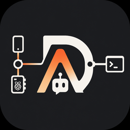

# AgentDock

<p align="center">
  
</p>

> AgentDock is an open-source **Agent Bridge / Runtime** that connects devices to agents through sessions and event streams.

AgentDock 是一个开源 **Agent Bridge / Runtime**：通过 Session 与 Event Stream 连接 Device 与任意 Agent。支持 **纯文本** 与 **语音** 双通道。

公网 Agent 接入规范：[`docs/AGENT_PROTOCOL.md`](./docs/AGENT_PROTOCOL.md)（协议标识 `agentdock.agent/1.0`）。

本机桌宠随 Runtime 一起开（不是远程客户端）：

```powershell
.\scripts\start.ps1          # Runtime + desktop pet
```

## 目录（按功能）

```text
runtime/          # 后端：协议、会话、Agent、STT/TTS、Admin
desktop/          # 本机桌宠 Tauri（置顶透明窗；不是 clients）
clients/          # 远程壳（手机等够不着 Runtime 时才需要）
  mobile/         # Flutter 远程壳（手机为主；Win·mac 壳仅手动/标签构建）
  cli/            # 调试 CLI（桌宠用 scripts/start.* / desktop/）
  shared/         # 协议 / 状态机
agents/           # 内置 Pi（pi-coding）+ demo 联调
catalog/          # 能力声明（pi / tts / stt / pets）
examples/         # 首启种子：vault-notes + demo 角色
assets/ brand|pets|voices
data/             # vault / installs / state / …
docs/ tests/ scripts/
config.yaml
```

若本机还残留旧版 `workspace/`，迁到 `data/` 并删除空壳：

```bash
python scripts/migrate_workspace_to_data.py --purge
```

## 完整链路

```text
desktop/ (本机桌宠)  ─┐
clients/mobile (壳) ──┼──WebSocket──►  runtime  ──►  Pi / Agent Protocol
                      │                    │
                      │               STT / TTS
                      ◄── 事件 + 语音 ─────┘
```

## 快速开始

**部署模型：** 本机 Runtime + **内置 Pi**（首启自动 `npm install`）；SoVITS 等可可选容器。  
见 [`docs/DEPLOY.md`](./docs/DEPLOY.md)。需本机 **Node.js LTS**（`npm`）与至少一个模型 API Key。

默认配置面向任意机器（Whisper `small` + `cpu`）。有 NVIDIA GPU 时：

```bash
cp config.cuda.example.yaml config.local.yaml   # gitignored；启动时自动合并
```

环境变量模板：复制 [`.env.example`](./.env.example) 为 `.env`；Runtime 启动时自动加载（已在 shell 中设置的变量优先）。

### 本机启动（完整功能 · 推荐）

脚本冷启动 **同一套宿主产品：Runtime 后台 + 本机桌宠**（并确保内置 Pi 依赖）；在桌宠控制台窗配 Key 后即可说话：

```powershell
# Windows
.\scripts\start.ps1              # Runtime + desktop pet
.\scripts\start.ps1 -Admin       # 桌宠内再开控制台窗口
.\scripts\start.ps1 -NoPet       # 只要 Runtime
.\scripts\stop.ps1
```

```bash
# Linux / macOS
chmod +x scripts/start.sh scripts/stop.sh
./scripts/start.sh               # Runtime + desktop pet
./scripts/start.sh --admin
./scripts/start.sh --no-pet
./scripts/stop.sh
```

```bash
# 或手动（仍需另开桌宠：cd desktop && npm run dev）
pip install -e ".[dev]"
python -m runtime
# 控制台是桌宠第二窗（Ctrl+Shift+A），不是单独的「网页后台」
```

### 可选：引擎容器（非 Runtime）

```bash
docker compose --profile engines up -d   # 例如 GPT-SoVITS → :9880
```

Runtime 演示镜像（**不能**一键拉起本机 Agent）见 `docker-compose.runtime-demo.yml`。

默认助手为项目内置 **Pi Coding**（`agents/pi-coding`），无需再装其它智能助手 CLI。  
桌宠控制台「智能助手」里配置 API Key 后启动即可。声音仍可用 Edge；SoVITS 可选。
`config.yaml` → `services.pi.autostart: true` 可在 Runtime 起来后自动拉起 Pi gateway。  
机器专属覆盖写在 `config.local.yaml`（不会进 git）。

Admin UI/API 仅接受本机访问（`Host: localhost` + loopback peer）；设备仍可从局域网访问 `/pets/*` 和 `/health`。Device WS 绑定 `0.0.0.0` 时默认需要 token（`data/state/device-auth.json`）。Admin
设置的默认 Agent/TTS/STT 保存在 `data/state/runtime-state.json`，不会改写 `config.yaml`。
安装收据与许可证确认保存在 `data/state/module-state.json`。
Agent 的公开模型选项保存在 `data/state/agent-settings.json`；统一 LLM 与各 Agent
的引用关系也写在同一文件。凭据与公开设置分离，Windows 下使用当前系统用户的
DPAPI 加密后写入 `data/state/agent-secrets.json`。

首启与模块启停：见 [`docs/ONBOARDING.md`](./docs/ONBOARDING.md)（Admin 总览直接检查/启动 Agent · TTS · STT · 人物）。

手动分步：

```bash
# Runtime 后台（设备 WS :8765 + 控制台/人物 HTTP :8766）
pip install -e .
python -m runtime
# 控制台 = 桌宠应用第二窗（Ctrl+Shift+A）— 服务启停 / 设备 / Agent / TTS

# 桌宠壳（Runtime 已在跑时；二者同属宿主产品）
python -m desktop

# CLI 调试
cd clients/cli
pip install -r requirements.txt
python main.py --chat --agent pi
python main.py --text "帮我整理桌面的文件"
```

## 接入公网 / 自建 Agent

```bash
# 参考 Agent + 链路探测（见 agents/）
python agents/demo/server.py
python agents/check_link.py --url http://127.0.0.1:8080/v1/agent/run

# config.yaml → agent.default: http
python clients/cli/main.py --text "你好" --agent http
```

安装与联调说明：[`agents/README.md`](./agents/README.md) · 协议：[`docs/AGENT_PROTOCOL.md`](./docs/AGENT_PROTOCOL.md) · [Provider 支持清单](./docs/PROVIDERS.md)。

## 默认能力

| 能力 | 默认 |
|------|------|
| STT | Whisper `small`；中文主机可切换 SenseVoice |
| TTS | Edge `zh-CN-XiaoxiaoNeural` |
| Agent | 内置 Pi Coding |

配置见 [`config.yaml`](./config.yaml)。跨网：[`docs/DEPLOY_TAILSCALE.md`](./docs/DEPLOY_TAILSCALE.md) · [`docs/DEPLOY_CLOUDFLARE.md`](./docs/DEPLOY_CLOUDFLARE.md)

## 交互入口

| 形态 | 路径 | 说明 |
|------|------|------|
| **本机桌宠** | [`desktop/`](./desktop/) | Tauri 置顶透明窗（`web/` 也可浏览器回退） |
| 远程壳 | [`clients/mobile/`](./clients/mobile/) | Flutter 手机远程操控宿主 Runtime；连 `ws://主机:8765` |
| 调试 CLI | [`clients/cli/`](./clients/cli/) | `--chat` / `--text`（桌宠：`scripts/start.*`） |

```bash
python -m desktop
cd clients/mobile && flutter run   # 远程壳；Android/iOS 见 Build Clients（Win/mac 壳仅手动或 client-v* 标签）
```

总览：[`clients/README.md`](./clients/README.md) · [`docs/DEVICES.md`](./docs/DEVICES.md) · [`docs/TECH_PLAN.md`](./docs/TECH_PLAN.md)

## 资源与署名

| 资源 | 来源 | 说明 |
|------|------|------|
| 角色（Pet） | 本机 `assets/pets/`（不入库） | 可从 [codex-pets.net](https://codex-pets.net) 等自行导入；说明：[`assets/pets/README.md`](./assets/pets/README.md) |
| TTS 音色包 | 本机 `assets/voices/<id>/`（不入库） | 权重 / wav 本机自备；说明：[`assets/voices/README.md`](./assets/voices/README.md) |
| TTS Edge | Microsoft Edge TTS | `config.yaml` 默认可选，无需本地模型 |

自定义角色 / 音色流程以 [`clients/CUSTOM_ASSETS.md`](./clients/CUSTOM_ASSETS.md) 为准。

## License

[MIT](./LICENSE) · 第三方语音/模型与再分发说明见 [`NOTICE`](./NOTICE) · 安全边界见 [`docs/SECURITY.md`](./docs/SECURITY.md)
